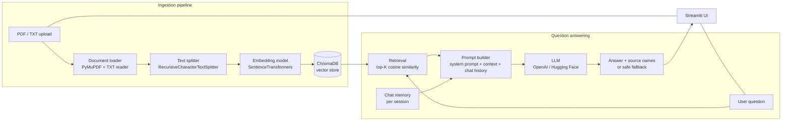

# 🤖 IntelliBot — Context-Aware RAG Chatbot


Code-A-Nova AI Internship · Month 1 project

IntelliBot is a chatbot that answers questions **only from documents you upload**
(PDF or TXT). If the documents do not contain the answer, it says so instead of guessing.

> **Current status: Day 7 (final) — feature-complete and heavily tested with stand-ins (mocks); the REAL embedding model, ChromaDB, LLM and Streamlit have never been run, and no evaluation scores exist yet.**
> This is **not** a claim of 100% completion: two deliverables of the official brief need actions only you can perform
> (a real RAGAS evaluation and the demo video). See the [checklist](#official-brief-checklist) and [What was tested for real](#what-was-tested-for-real-and-what-was-not).

---


Live At : https://intellibot-context-aware-rag-chatbot.streamlit.app/ 


## What IntelliBot does

IntelliBot is a **Retrieval-Augmented Generation (RAG) chatbot**. You upload your own documents; it splits them into pieces, turns the pieces into
numbers (embeddings), saves them in a vector database (ChromaDB) and, when you ask a question, finds the most similar pieces and asks a language model to
answer **using only those pieces**. Every answer shows its **sources** (file, page, passage). If the documents do not contain the answer, it says so instead of guessing.

## Main features

- **Documents:** upload PDF and TXT files (several at once); one bad file never stops the others; clear messages for empty, damaged, password-protected, scanned or oversized files.
- **Search index:** overlapping chunks with page numbers, local embeddings (no API key), a persistent ChromaDB index that skips documents already saved.
- **Grounded answers:** the model is told to use only the retrieved passages; replies must cite real passages or they are hidden; numbers/file names not found in the sources trigger warnings; no relevant passage means the model is not even asked.
- **Conversation:** follow-up questions ("What about the second option?"), clarification questions when unclear, a limited per-session memory, **Clear chat**, and isolation between visitors.
- **Safety:** API keys only from `.env` / Secrets, masked everywhere (including a key pasted into a question), partial prompt-injection protection (with documented limits), friendly error messages with a next step, no stack traces shown.
- **Interface:** Streamlit chat bubbles, tabs (💬 Chat, 📄 Documents, 🔎 Search), setup checklist, sources you can open, spinner while working, mobile-friendly layout.
- **Evaluation toolkit (Day 7):** a 24-question ground-truth set, retrieval/latency/hallucination metrics and an optional RAGAS adapter. See [Evaluation](#evaluation).

## Prerequisites

- **Python 3.11 or newer** (3.12 was used for development).
- Internet access for the first install (several hundred MB: PyTorch for `sentence-transformers`, ChromaDB) and the first run (the ~90 MB embedding model download).
- An **OpenAI** (or Hugging Face) **API key** only if you want written answers; uploading, indexing and search work without one.
- No special hardware. A GitHub Codespace (works from a phone browser) is enough.

## Supported document formats (from the actual code)

| Format | How it is read | Notes |
|---|---|---|
| `.pdf` | PyMuPDF (main); `pypdf` is the backup if PyMuPDF is not installed | text PDFs only; **scanned/image PDFs are rejected** (no OCR); password-protected PDFs are rejected with a clear message; damaged files are rejected |
| `.txt` | UTF-8 (with or without BOM), UTF-16, then Windows-1252 / Latin-1 with a warning | binary files named `.txt` are rejected |
| anything else (DOCX, images, ...) | not supported | the app says so |

Limits: 10 MB per file by default (see `MAX_UPLOAD_MB` and the Streamlit cap below).

## Official brief checklist

Checked against the brief in the project files (`Month 1 - IntelliBot`). "Done" means the code, tests and documentation exist; it does **not** mean it was run with real services.

| Brief item | Status |
|---|---|
| 1. Complete Python source with a clean structure | ✅ Done |
| 2. `requirements.txt` | ✅ Done (version ranges not install-tested; optional `requirements-eval.txt` for RAGAS) |
| 3. Sample knowledge-base PDFs (3–5) | ✅ 4 PDFs + 1 TXT (fictional company) |
| 4. Streamlit app running locally or deployed | 🟡 App is complete and tested against a **mock** of Streamlit. **Never run with real Streamlit; not deployed.** Run it yourself (Setup below). |
| 5. RAGAS evaluation score report | 🔴 **Not produced.** The dataset, metrics code, RAGAS adapter and one-command script exist, but real scores need real services. [`docs/EVALUATION_REPORT.md`](docs/EVALUATION_REPORT.md) honestly says NOT RUN until you run the script. |
| 6. Video demonstration | 🔴 **You must record it.** A script and sample questions are in [`docs/DEMO_GUIDE.md`](docs/DEMO_GUIDE.md). |
| 7. README with architecture diagram and setup instructions | ✅ Done (diagram below) |
| Answers only from the documents; hallucination fallback | ✅ Designed and tested with stand-ins; real-model behaviour unverified |
| Vector search + embedding under 2 seconds per query | 🟡 Not measured. `python scripts/run_evaluation.py --mode local` measures it on real services and reports pass/fail. |
| PDF parsing errors handled gracefully | ✅ Tested with real damaged/encrypted/blank PDFs (via the pypdf backup) |
| API keys only in `.env`, never hard-coded | ✅ Tested (scans for keys in all non-test files) |
| Tech-stack table: "LangChain or LlamaIndex" | 🟠 **Deviation:** neither is used. IntelliBot has its own small, tested modules (recursive splitter, ChromaDB wrapper, OpenAI-compatible client). |
| Tech-stack table: `ConversationBufferMemory` | 🟠 **Deviation:** a custom per-session memory (last N exchanges, masking, clear) is used instead (the project notes allow "an appropriate maintained memory implementation"). Be ready to explain this choice in your presentation. |
| Tech-stack table: RAGAS | 🟡 Optional adapter written against RAGAS's documented API; never run. |

## What was tested for real and what was not

The development environment had **no internet, no API key, and could not install** Streamlit, ChromaDB, sentence-transformers, PyMuPDF, openai or ragas.

| Part | Tested for real? | How |
|---|---|---|
| PDF/TXT loading and error handling | ✅ real files | via the `pypdf` backup. **PyMuPDF itself: not tested** |
| Chunking, memory, follow-up rules, masking, prompt building, answer checks, config, UI helpers, evaluation maths | ✅ real code | pure-logic tests |
| Embeddings (SentenceTransformers) | ❌ no | stand-in embedder; the real model never ran |
| ChromaDB | ❌ no | a mock of the chromadb API (33 tests that use the real package exist and skip until it is installed) |
| LLM (OpenAI / Hugging Face) | ❌ no | scripted stand-in; one opt-in live test exists |
| Streamlit interface | ❌ no real Streamlit | the real `app.py` run against a recording mock; looks and browser behaviour never seen. Two real `AppTest` tests exist and skip until Streamlit is installed |
| RAGAS and the evaluation scores | ❌ no | adapter tested with a fake `ragas` module; **no score has ever been produced** |
| Deployment (Streamlit Cloud) | ❌ no | — |

**What to do to close the gaps** (about 30 minutes in a GitHub Codespace): install the requirements, run `python -m pytest -q` (the skipped real-service tests now run),
start the app, ask the demo questions, and run the evaluation. Send me any error text and it can be fixed.

---


## Architecture



| Step | Built on |
|---|---|
| Document loader, config, UI shell | **Day 1 ✅** |
| Chunking + embeddings | **Day 2 ✅** |
| ChromaDB + similarity search | **Day 3 ✅ code, real ChromaDB unverified** |
| RAG prompt + LLM + fallback + sources | **Day 4 ✅ code; no live LLM tested** |
| Conversation memory, follow-ups, Clear chat, session isolation | **Day 5 ✅ code; no live LLM tested** |
| Polished chat interface: bubbles, tabs, sources, loading/error states, mobile layout | **Day 6 ✅ code; mock-Streamlit tests only, not seen in a real browser** |
| RAGAS evaluation + polish | Day 7 |

---

## Project structure

```
intellibot/
├── app.py                      # Streamlit app
├── core/
│   ├── config.py               # settings, .env handling (no secrets in code)
│   ├── document_loader.py      # PDF/TXT reading + error handling      (Day 1)
│   ├── chunking.py             # recursive chunking + chunk metadata   (Day 2)
│   ├── embeddings.py           # embedder interface, SentenceTransformers, cache (Day 2)
│   ├── vector_store.py         # persistent ChromaDB store: add, search, dedupe (Day 3)
│   ├── indexing.py             # chunks -> embeddings -> ChromaDB, skips unchanged docs (Day 3)
│   ├── retrieval.py            # question -> top-K relevant chunks + clear status (Day 3)
│   ├── llm.py                  # LLM client (OpenAI / Hugging Face), safe errors (Day 4)
│   ├── prompting.py            # grounded prompt + prompt-injection defences (Day 4)
│   ├── answering.py            # retrieval -> LLM -> checked answer with sources (Day 4)
│   ├── memory.py               # ChatSession: per-session history, limits, secret masking (Day 5)
│   ├── followup.py             # follow-up detection, rewrite prompt, clarification (Day 5)
│   ├── conversation.py         # memory + follow-ups on top of the answer engine (Day 5)
│   ├── ui_helpers.py           # friendly errors, setup checklist, safe details, CSS - no Streamlit (Day 6)
│   ├── evaluation.py           # ground-truth cases, retrieval/answer/hallucination metrics, report (Day 7)
│   └── ragas_eval.py           # optional RAGAS adapter (never run) (Day 7)
├── data/sample_docs/           # 5 fictional demo documents (4 PDF + 1 TXT)
├── data/eval/eval_cases.json   # 24 evaluation questions with checked ground truth (Day 7)
├── scripts/generate_sample_docs.py   # re-creates the sample documents (needs reportlab)
├── scripts/run_evaluation.py   # runs the evaluation and writes docs/EVALUATION_REPORT.md (Day 7)
├── tests/                      # automated tests (fake_chroma.py, fake_streamlit.py, llm_helpers.py = MOCKS, tests only)
├── docs/                       # PROGRESS.md, GITHUB_UPLOAD_GUIDE.md, DEMO_GUIDE.md, EVALUATION_REPORT.md
├── .streamlit/config.toml
├── chroma_db/                  # created automatically: the saved search index (never uploaded)
├── .env.example                # copy to .env and add your own keys
├── requirements.txt
├── requirements-dev.txt        # extra packages for tests (pytest, reportlab)
├── requirements-eval.txt       # optional: ragas, for the RAGAS scores
└── .gitignore
```

---

## Setup

### Option A — Run on a computer
1. Install Python 3.11 or newer.
2. Open a terminal in the `intellibot` folder.
3. `python -m venv .venv` then activate it (`source .venv/bin/activate` on Mac/Linux, `.venv\Scripts\activate` on Windows).
4. `pip install -r requirements.txt`
5. Copy `.env.example` to `.env` (an API key is only needed from Day 4).
   Note: `pip install` now also installs `sentence-transformers` and PyTorch (a big download).
6. `streamlit run app.py`

### Option B — Deploy to Streamlit Community Cloud (works from a phone browser)
1. Upload this project to your own GitHub repository (see [docs/GITHUB_UPLOAD_GUIDE.md](docs/GITHUB_UPLOAD_GUIDE.md)).
2. Go to https://share.streamlit.io and sign in with GitHub.
3. Choose **Create app**, pick your repository, branch `main`, and main file `app.py`.
4. Open **Advanced settings → Secrets** and paste your keys in this form (never put real keys in GitHub):
   ```toml
   OPENAI_API_KEY = "your-key-here"
   ```
5. Deploy.

> Deployment has **not** been tested yet for this project.

### API keys and LLM provider setup (Day 4)

**Which features need a key?** Only the **written answers** (section 5, *Ask questions*). Uploading, chunking, embeddings,
indexing and **search work without any key**. Without a key the app says so and still shows the passages it found.

**Choose one provider** (set `LLM_PROVIDER` to `openai` or `huggingface`):

| | OpenAI | Hugging Face |
|---|---|---|
| Get a key | platform.openai.com → API keys (needs a payment method) | huggingface.co/settings/tokens |
| Variable | `OPENAI_API_KEY` | `HUGGINGFACEHUB_API_TOKEN` |
| Model variable (default) | `OPENAI_MODEL` (`gpt-4o-mini`) | `HUGGINGFACE_MODEL` (`mistralai/Mistral-7B-Instruct-v0.3`) |
| How it is called | official `openai` package | the same package, via Hugging Face's OpenAI-compatible endpoint (`HUGGINGFACE_BASE_URL`) |

**Where to put the key (never in the code, never on GitHub):**
- *Local computer:* copy `.env.example` to `.env`, replace the placeholder with your key.
- *GitHub Codespace:* create the `.env` file in the Codespace (it is ignored by Git), or add a Codespaces secret.
- *Streamlit Community Cloud:* **App → Settings → Secrets**, e.g. `OPENAI_API_KEY = "your-key"`.

**Has any provider been tested live? No.** The build environment had no internet and no key, so no real OpenAI or
Hugging Face call has ever been made. The client is written from the providers' public documentation and tested only with
stand-ins. Your first real question is the first live test: please report any error text. The Hugging Face model name
and endpoint availability, and newer OpenAI models that need different request settings, are unverified.

Keys are only read from environment variables / Secrets, are never printed or logged, and never appear in error messages.

---

## Using the app (Days 1–6)

The page has three tabs and a sidebar. A one-line checklist at the top (✅ / ⬜) always shows what is still missing.

1. **📄 Documents tab → add documents:** upload PDF/TXT files, or tap **Use sample documents**. Each file shows ✅ (pages, characters, preview) or ❌ with a plain-English reason. One bad file never stops the others.
2. **📄 Documents tab → chunks:** every document is cut into overlapping chunks automatically; open one to see its first chunks.
3. **📄 Documents tab → index:** tap **Create embeddings and index**. The first time, a ~90 MB model is downloaded. Chunks and embeddings are saved in a ChromaDB index (`chroma_db`); tapping again skips documents that are already saved. *Manage the saved index* lets you remove your documents from it (or, advanced, clear all of it).
4. **💬 Chat tab:** type a question in the box at the bottom and send it. Your message and the answer appear as chat bubbles (🧑 you, 🤖 IntelliBot). While IntelliBot searches and writes, a spinner is shown; the answer appears only when it is really finished.
5. **Sources:** under each answer you see `📎 Sources: file (page)` and **View sources and excerpts**, which lists the passages the answer is based on (real file name, page, chunk, similarity, text). Passages that were checked but not used are listed separately. If the documents do not contain the answer, IntelliBot says so and shows no sources as support.
6. **Follow-ups:** keep asking, for example *"What about the second option?"*. IntelliBot works out what you mean from this chat, shows how it understood you (🔎) and still searches your documents. If it cannot tell, it asks you to clarify (❓).
7. **🧹 Clear chat:** in the chat tab and in the sidebar. It forgets only your conversation; your documents, the saved index and other visitors' chats are not touched.
8. **🔎 Search tab:** the plain search from Day 3 (no answer is written, no API key needed).
9. **Sidebar:** setup checklist, API-key status (never the key itself), models, index size, how many exchanges are remembered, and a short "How to use" guide.

If something is missing (no documents, not indexed, no ChromaDB / embedding library, no API key) the chat tells you what to do next, and only the parts that need it are switched off. Without ChromaDB the Day 2 behaviour remains: embeddings are created in memory only and not saved.

---

## How Day 2 works

**Chunking** (`core/chunking.py`) — documents are split on the biggest natural boundary that fits:
paragraphs → sentences → lines → words → (last resort) fixed-size cuts. Neighbouring pieces are merged up to the
chunk size, and each new chunk starts with a short repeat of the previous chunk's ending (the *overlap*) so
facts at a boundary are not cut in half. This follows the idea of LangChain's `RecursiveCharacterTextSplitter`, but is
a small own implementation (no extra dependency) that also tracks exact positions. It does **not** use LangChain's class.

Every chunk keeps: source file name, file hash, chunk index, total chunks, start/end page, and start/end character position.
`chunk.text` is always exactly `document.text[char_start:char_end]`.

**Embeddings** (`core/embeddings.py`) — `Embedder` is a small interface (`embed_documents`, `embed_query`) so Day 3's
search does not depend on a specific model. `SentenceTransformerEmbedder` is the real implementation
(`all-MiniLM-L6-v2` by default, runs on your machine, vectors normalised for cosine similarity).
`embed_chunks` embeds chunks and reuses vectors for unchanged text through an in-memory cache.

## How Day 3 works

**Vector store** (`core/vector_store.py`) uses the real `chromadb` package: `PersistentClient`, one collection per embedding model,
cosine distance. Each stored chunk keeps its text, vector and metadata (source file, file hash, chunk index, page range, character positions).
A search returns the top-K chunks with `score = 1 - cosine distance` (higher = more similar).

**Saved on disk:** the index lives in the `chroma_db/` folder (`VECTOR_STORE_DIR`) and is reused after the app restarts.
On Streamlit Community Cloud the disk is temporary, so the index is rebuilt after the app sleeps or restarts.

**No duplicates:** a document is identified by its file hash. Indexing the same document again writes nothing and does not call the embedding model.
If the same file is chunked differently (new `CHUNK_SIZE`), its old chunks are replaced, never mixed with the new ones.
Different embedding models use different collections, so their vectors are never mixed.

**Privacy between visitors:** the index is shared on disk, but every search is limited to the documents loaded in the *current* browser session,
so one visitor cannot retrieve another visitor's files.

**Retrieval** (`core/retrieval.py`) embeds the question and returns a response with a clear `status`:
`ok`, `empty_query`, `query_too_long`, `no_documents` (nothing indexed) or `no_relevant_results` (chunks exist but none reaches `MIN_SIMILARITY`).
Day 4 uses these statuses to give the safe "not in the documents" fallback instead of guessing.

**Not "chat" yet:** search shows matching passages. Generating an answer with an LLM starts on Day 4.

## How Day 4 works

**Flow for each question** (`core/answering.py`):
1. **Retrieve** the most relevant chunks (Day 3), limited to the documents of your session.
2. **No relevant chunk found → safe fallback.** The LLM is *not called at all*, so it cannot invent an answer.
3. Otherwise a **grounded prompt** is sent to the LLM: fixed rules + numbered passages `[S1]`, `[S2]`… + your question.
4. The reply is **checked before it is shown**:
   - `NOT_IN_DOCUMENTS` reply → the honest fallback message.
   - Citations like `[S2]` must point to passages that were really retrieved. Unknown ones are removed and reported.
   - A reply with **no valid citation is not shown** (status "unverified").
   - Numbers in the answer that do not occur in the sources, and file names that were not retrieved, produce a visible warning (a hint of hallucination, not proof).
   - A reply that leaks the secret marker of the system prompt is blocked.
   - Markdown images and web links are removed before display (a known way to leak data from an answer).
5. The answer is shown with its **sources**. Only passages that were actually retrieved are ever listed, with their real file names and pages.

**Each failure has its own message**, so you can tell what went wrong:
retrieval/embedding/index problem · no API key or `openai` package missing · LLM provider error (bad key, rate limit, timeout, no connection, unknown model) ·
nothing indexed · empty or too long question · documents do not contain the answer.
Provider error texts are never shown (only short, friendly messages), and logs contain only the error *type*.

### Prompt-injection protection — and its limits

Uploaded documents are **untrusted**: a file may contain text such as "ignore previous instructions". IntelliBot reduces this risk by:
- a fixed system prompt that says the passages are data, not instructions, and that the question cannot change the rules;
- putting passages and the question in the *user* message inside delimiters, never in the system message;
- escaping `<` and `>` in passages, file names and the question, so a document cannot close tags or fake a `<system>` block;
- repeating a reminder *after* the untrusted text;
- detecting typical attack phrases in retrieved passages and **warning you** (the passage is still treated as data);
- the output checks listed above (citations, leaked prompt marker, link/image stripping).

**This does not fully solve prompt injection. Please do not rely on it as complete protection.**
- A real language model can still be tricked by clever wording. The detection list is simple and can be bypassed or give false alarms.
- If a manipulated reply still carries a valid citation `[S1]`, IntelliBot cannot tell (there is a test that documents this limit).
- The number and file-name warnings are heuristics. Answers can still be wrong; always check the sources.
- All injection tests use a **scripted stand-in model**. They prove IntelliBot builds the prompt safely and checks replies, **not** that a real model resists attacks.

## How Day 5 works

**Memory** (`core/memory.py`): each browser session gets its own `ChatSession` (kept in Streamlit's per-session state). It remembers only the last
`CHAT_HISTORY_TURNS` question/answer exchanges (default 4, `0` = memory off, max 20); older ones are dropped. It lives only in memory:
nothing is written to disk or logs, it disappears when the browser session ends, and `repr()` never prints conversation text.

**Follow-ups** (`core/followup.py`, `core/conversation.py`): for each question IntelliBot decides what to search for:
1. A normal, self-contained question is used as it is (no extra model call).
2. A follow-up ("What about…", "And for…", "the second option", "explain that") is turned into a **standalone question** by the language model, using the recent
   conversation only to work out what it refers to. The standalone question then goes through the normal pipeline: retrieval from **your own documents**, grounded prompt, answer checks, sources.
3. If there is nothing to refer to (no earlier question, or no earlier answer to point at) or the model says it cannot tell, IntelliBot **asks you to clarify** and does not search or guess.
4. Without an API key, or if the rewrite fails or is unusable, a simple rule is used: the topic of your previous question is carried over, so searching still works.

**Grounding is unchanged.** Earlier answers are used only to interpret the follow-up. They are **never** put into the answering prompt and **never** count as evidence:
facts must come from freshly retrieved passages, must be cited with `[S#]`, and still get the number / file-name / citation checks. If the standalone question finds nothing relevant, you get the usual "not in your documents" reply and the answering model is not called.
Only real answers, "not found" replies and clarifications are remembered; errors, empty questions and hidden/unverified replies are not.

**Safety of the rewrite step:** the rewritten question must be a single short line that looks like a question, shares a word with the conversation, contains no injection phrases and no prompt marker; otherwise it is discarded.
Conversation text is escaped inside delimiters, and earlier assistant answers are shortened, stripped of citations and tagged as data in the prompt.

**Isolation and privacy**
- One `ChatSession` per browser session; no global history. The engine holds no per-user state. Searches stay limited to the documents of the current session (Day 3).
- A key pasted into a question is masked (`[redacted]`) **before** it is searched, sent to the model, shown again or remembered; your configured keys are masked everywhere in the history.
- Clear chat calls `ChatSession.clear()` only. It cannot touch the shared index or anyone else's chat.

**Cost note:** a follow-up uses one extra (short) LLM call for the rewrite.

## How Day 6 works

**Run it**
```
pip install -r requirements.txt          # Streamlit, ChromaDB, sentence-transformers, openai, ...
cp .env.example .env                     # then put YOUR key in .env (never upload .env)
streamlit run app.py
pip install -r requirements-dev.txt && python -m pytest    # run the tests
```
(On Streamlit Community Cloud, put the keys in *App → Settings → Secrets* instead of `.env`.)

**Layout and design**
- Streamlit-native components only: `st.chat_message` bubbles with avatars, `st.chat_input`, `st.tabs`, `st.expander`, `st.spinner`, bordered containers. No extra UI dependency, no animation.
- **Mobile-friendly:** centred single column, full-width buttons with a minimum height of about 44 px, no tables or wide widgets, long text and file names wrap instead of scrolling sideways, narrow-screen spacing, and the long source lists are folded into expanders so the chat stays short. One small static stylesheet (`core/ui_helpers.py → CSS`) does this; it is the only place raw HTML is allowed and it never contains user text or secrets.
- **No duplicate messages:** `st.chat_input` returns a question only on the run in which it was sent, and it clears itself. Streamlit re-runs the whole script on every click; the conversation is redrawn from the session's history each time, so nothing is added twice and the model is not called again.
- **Loading state:** a spinner inside the assistant bubble while the documents are searched and the answer is written; nothing is drawn as "ready" before the work has finished.
- **Errors:** each problem has its own title, a plain explanation and a **next step** (retrieval/index problem, no API key, AI-service error, nothing indexed, empty or too-long question, answer not in the documents, unverifiable reply). No stack traces and no keys are ever shown. A collapsed **🔧 Technical details** box shows safe facts (status, model, search result, best similarity, timing) for debugging.
- **Privacy in the interface:** a key pasted into a question is masked (`[redacted]`) before it is shown, searched, sent to the model or remembered; your configured keys are also masked in everything that is drawn (answers, warnings, errors).
- **Code layout:** `core/ui_helpers.py` holds all UI decisions that need no Streamlit (messages, checklist, texts) and is tested directly; `app.py` only draws. No retrieval, answering, memory or masking logic was duplicated or changed in Day 6.

### Settings (in `.env`, all optional)

| Setting | Default | Meaning |
|---|---|---|
| `MAX_UPLOAD_MB` | 10 | Largest accepted file. **Streamlit has its own cap:** if you raise this, also raise `maxUploadSize` in `.streamlit/config.toml`, or larger files are refused before IntelliBot sees them |
| `CHUNK_SIZE` | 600 | Max characters per chunk (100–4000) |
| `CHUNK_OVERLAP` | 100 | Characters repeated between chunks (0 to half of size) |
| `EMBEDDING_MODEL` | `sentence-transformers/all-MiniLM-L6-v2` | Local embedding model |
| `EMBEDDING_BATCH_SIZE` | 32 | Texts embedded per batch |
| `VECTOR_STORE_DIR` | `chroma_db` | Folder of the saved ChromaDB index |
| `TOP_K` | 4 | Default number of chunks per search (1–50) |
| `LLM_PROVIDER` | `openai` | `openai` or `huggingface` |
| `OPENAI_MODEL` / `HUGGINGFACE_MODEL` | see above | Chat model used for answers |
| `CHAT_HISTORY_TURNS` | 4 | Exchanges remembered per chat (0 = memory off, max 20) |
| `LLM_MAX_TOKENS` | 500 | Maximum answer length (50–4000) |
| `LLM_TIMEOUT_SECONDS` | 30 | How long to wait for the LLM (5–300) |
| `HUGGINGFACE_BASE_URL` | `https://router.huggingface.co/v1` | Hugging Face OpenAI-compatible endpoint |
| `MIN_SIMILARITY` | 0.2 | Lowest cosine similarity counted as relevant (0–1). **Not calibrated yet** with the real model; tune it with real questions on Days 4 and 7 |

Invalid values are ignored and the defaults are used.

---

## Evaluation

The brief asks for a RAGAS evaluation (faithfulness, answer relevancy, context precision), hallucination testing and a speed limit of 2 seconds per query.
IntelliBot ships the **tools** for this and an honest **NOT RUN** report. **No evaluation score has ever been produced.**

**What exists**
- `data/eval/eval_cases.json`: 24 questions about the sample documents: 14 whose answer is in the documents, 2 follow-ups, 6 whose answer is **not** in the documents (hallucination traps, e.g. "What is the CEO's salary?") and 2 attack attempts. Tests prove that every expected fact is a literal phrase of its source document.
- `core/evaluation.py`: retrieval metrics (right document retrieved, expected fact present, traps rejected, latency), answer metrics (key facts, correct citation, refusals, **hallucination count**, prompt leaks) and the report writer.
- `core/ragas_eval.py` + `requirements-eval.txt`: optional RAGAS adapter (needs the `ragas` package, an **OpenAI key** as the judge, and internet).
- `scripts/run_evaluation.py`: one command that uses only REAL services.

**How to run it** (needs the real requirements installed, e.g. in a Codespace)
```
python scripts/run_evaluation.py --mode local     # real embedding model + ChromaDB, no API key: retrieval quality + speed
pip install -r requirements-eval.txt              # only for full mode
python scripts/run_evaluation.py --mode full      # also real answers, hallucination checks and RAGAS (needs OPENAI_API_KEY)
```
Each command overwrites `docs/EVALUATION_REPORT.md` with the real report. If a service is missing, the script explains what and **stops without writing anything**, so a failed run can never overwrite the report or produce made-up numbers. (In the development environment this stop was the real outcome: exit code 2 and no file.)

**How to read the report**
- *Right document among the retrieved passages / expected fact present:* did retrieval find the evidence? Low numbers mean the search (chunk size, `TOP_K`, `MIN_SIMILARITY`, embedding model) needs tuning, not that the LLM is bad.
- *Unsupported questions rejected at retrieval:* how often nothing passed the similarity threshold. A low number is normal: the LLM step can still refuse. The final safety measure is in section 2.
- *Hallucinations:* unsupported questions that still got a **cited answer**. The goal is 0. Any listed question deserves a look.
- *Latency:* the slowest query must be below 2 seconds for the brief's requirement to be met. The first query loads the model and is reported separately.
- *RAGAS scores (0 to 1, higher is better):* faithfulness (is the answer supported by the passages?), answer relevancy (does it address the question?), context precision (are the useful passages ranked first?). They are judged by an LLM, vary a little between runs and are only meaningful on a real run.
- The key-fact checks are simple text matches, not human grading.

**Actual results versus NOT RUN.** A report from real services says *Real services: yes*. A report made with stand-ins carries a warning banner and must never be shown as a result. The report in this repository is the **NOT RUN** template; a test refuses to accept a stand-in report there.

---

## Testing

```
pip install -r requirements-dev.txt
python -m pytest            # or:  python -m unittest discover -s tests -t .
```

Test types are labelled inside the test files:
- **REAL** — real code and real files, no stand-ins.
- **MOCK** — a stand-in (`tests/fake_chroma.py`, a fake embedder) checks IntelliBot's own logic only. It does **not** prove real ChromaDB or the real model works.
- **OPTIONAL** — run only if the real package is installed (PyMuPDF, SentenceTransformers + model, **ChromaDB**), otherwise skipped.
- **MOCK Streamlit** — `tests/fake_streamlit.py` imitates Streamlit and records what `app.py` draws, so the real `app.py` is run and checked for what is shown, where and in what order (bubbles, sources, spinner, errors, Clear chat, two separate sessions, masking). **It cannot show how the page looks, or that it works in a real browser or on a phone.**
- **OPTIONAL real Streamlit** — two tests using Streamlit's own `AppTest`; skipped unless `streamlit` is installed (never run in the build environment).
- **STAND-IN evaluation** — the evaluation tests (`test_evaluation.py`, `test_ragas_eval.py`) compute metrics with controlled stand-ins so the numbers can be checked by hand; they test the evaluation CODE, not IntelliBot's quality. Only the dataset checks run on real documents.
- **Integrity & regression** — `test_project_integrity.py` (REAL) checks that every imported package is declared, every setting is documented and forwarded from Streamlit Secrets, no key-like strings exist outside the tests, required files and the brief's sample-document rule hold; `test_regressions.py` has one test per bug fixed on earlier days.
- **LIVE** — one real LLM call. Runs only if you set `RUN_LIVE_LLM_TESTS=1` **and** a real API key; otherwise skipped (it may cost a tiny amount). It has never been run.

All Day 4 and Day 5 answer, prompt-injection and follow-up tests use a scripted stand-in LLM (`tests/llm_helpers.py`): they check IntelliBot's own logic (when the model is asked, what is done with its reply, isolation, limits, grounding), **not** how a real model interprets follow-up questions.

**How to verify real ChromaDB yourself:** run the command above on a machine where `pip install -r requirements.txt` worked
(for example a GitHub Codespace). The 33 skipped "real chromadb" tests then run automatically against the real package.
A green run with those tests skipped means the real ChromaDB integration is **unverified**.

See [docs/PROGRESS.md](docs/PROGRESS.md) for the exact results.

---

## Progress

| Feature | Status |
|---|---|
| Environment setup, `.env` config, key hiding | ✅ Done |
| PDF/TXT loading with error handling | ✅ Done |
| Sample documents (5 files) | ✅ Done |
| Streamlit shell: uploader, status, previews | ✅ Done (not yet run in a real browser) |
| Recursive chunking with overlap + metadata | ✅ Done (tested) |
| Embedding interface, SentenceTransformers embedder, cache | ✅ Done — real model **not yet run** (no internet in the build environment); tested with stand-in models |
| Chunk preview + "Create embeddings" in the app | ✅ Done (not yet run in a real browser) |
| ChromaDB persistent store, duplicate handling, top-K search, retrieval statuses | ✅ Code done. Tested with a **mock** of chromadb only; real ChromaDB **unverified** |
| Index + search in the app | ✅ Done (not yet run in a real browser) |
| LLM client (OpenAI / Hugging Face), grounded prompt, answer checking, source attribution, safe fallback | ✅ Code done. Tested with a **stand-in LLM** only; **no live provider tested** |
| Prompt-injection defences | ✅ Partial protection, documented limits; tested with scripted stand-ins only |
| "Ask questions" in the app | ✅ Done (not yet run in a real browser) |
| Conversation memory, follow-up handling, clarification, Clear chat, history limit, session isolation, secret masking | ✅ Code done. Tested with a **stand-in LLM**, mock ChromaDB and a stand-in embedder only; real follow-up interpretation **unverified** |
| Conversation in the app (follow-ups, Clear chat, earlier exchanges) | ✅ Done (not yet run in a real browser) |
| Polished chat interface (bubbles, tabs, sources, loading/error states, setup checklist, mobile layout, masking in the UI) | ✅ Code done. Tested against a **mock of Streamlit** only; **not seen in a real browser or on a phone** |
| Evaluation toolkit: 24-question ground truth, retrieval/latency/hallucination metrics, report writer, one-command script | ✅ Code done and tested with stand-ins. **No real evaluation run yet** |
| RAGAS adapter | 🟡 Written against RAGAS's documented API, tested with a fake `ragas` module; **never run** |
| Evaluation report (brief deliverable 5) | 🔴 **NOT RUN** (report says so). You run `scripts/run_evaluation.py` on real services to produce it |
| Demo guide and sample questions | ✅ [docs/DEMO_GUIDE.md](docs/DEMO_GUIDE.md) |
| Demo video (brief deliverable 6) | 🔴 **Must be recorded by you** |
| Integration/consistency checks, regression suite | ✅ Done (real) |

See [docs/PROGRESS.md](docs/PROGRESS.md) for test results and known limitations.

---

## Sample documents

To re-create them (needs `pip install reportlab`): `python scripts/generate_sample_docs.py`.

The files in `data/sample_docs/` describe a **fictional** company (NovaTech Solutions),
so answers cannot come from the model's general knowledge — ideal for checking that the bot
is really grounded in the documents.

## Limitations (Day 7 — the project as a whole)
- **Nothing that needs a network or a heavy library has been run:** real Streamlit, ChromaDB, sentence-transformers, PyMuPDF, an LLM and RAGAS. Expect to meet small integration problems on your first real run; the error messages are written to point at the cause.
- **No evaluation scores exist.** Deliverable 5 needs you to run the script; deliverable 6 (video) needs you to record it.
- The 2-second query limit is **unmeasured**; `MIN_SIMILARITY=0.2`, the chunk size and `TOP_K` are untuned defaults.
- LangChain/LlamaIndex and `ConversationBufferMemory` are not used (documented deviation from the brief's tech table).
- Dependency version ranges (`streamlit`, `chromadb`, `sentence-transformers`, `openai`, `pymupdf`, `ragas`) were not install-tested. Installing `sentence-transformers` brings PyTorch (large); Streamlit Cloud suitability is untested.
- Prompt-injection protection is partial; answers can still be wrong. Always check the sources.
- English-centred follow-up detection; no OCR for scanned PDFs; only PDF and TXT.
- Chat history is per browser session and lost on refresh; the shared index lives on the server disk (temporary on Streamlit Cloud).
- The evaluation's automatic checks (key terms, fact in text) are rough proxies; RAGAS needs an OpenAI key and is LLM-judged.
- The Day 6 limitations (interface never seen in a real browser/phone) still apply:
- **The interface has never been seen in a real browser or on a real phone.** It was tested by running `app.py` against a mock of Streamlit. Colours, spacing, the CSS selectors (they rely on Streamlit's internal `data-testid` names, which can change between versions), tap-target sizes and scrolling are unverified. The "mobile" tests are structural checks (centred layout, full-width buttons, no wide widgets, static stylesheet), not device tests.
- `st.chat_input` is placed inside the Chat tab, where Streamlit is expected to draw it inline below the messages rather than pinned to the bottom of the screen (not verified).
- Tabs cannot be switched by the app, so after adding documents you tap the 💬 Chat tab yourself (the checklist and banners tell you when).
- The two OPTIONAL tests with Streamlit's real `AppTest` have never been run. Real ChromaDB, real embeddings and a real LLM remain untested (see below).
- The Day 5 limitations still apply:
- **Follow-up interpretation has never been tried with a real language model.** The rewrite prompt and the decision rules are tested with a scripted stand-in only. Real models may rewrite badly, over-ask for clarification, or the rule-based detector may miss or over-detect follow-ups (it uses simple English patterns, so other languages and unusual phrasing are not recognised as follow-ups).
- A follow-up costs an extra LLM call. If the rewrite is wrong, the answer may be about the wrong topic; the "I understood your question as…" line lets you notice and rephrase.
- The rule-based fallback (no key / failed rewrite) just prepends the previous topic and can be wrong, for example when you change subject.
- Memory is per browser session and lost on refresh or when the app restarts (by design: nothing is saved). It is not an account system.
- Isolation relies on Streamlit's per-session state. No multi-user load test and no deployment test were done.
- Masking recognises common key formats and your configured keys; it cannot recognise every kind of private data a user might type.
- The earlier limitations (Day 4) still apply:
- **No live LLM call has ever been made.** Provider behaviour, the Hugging Face model/endpoint, answer quality and whether real models follow the "cite every fact" rule are all unverified. If a real model forgets citations, its answer is shown as "unverified" instead of being displayed (strict on purpose); this may need tuning.
- Prompt-injection protection is partial (see above).
- Number/file-name checks are heuristics; they cannot check meaning. Calculations (e.g. adding two numbers) can trigger a harmless warning.
- Answers need the internet and an API key; some providers charge per request.
- **Real ChromaDB has not been run.** The integration is written against ChromaDB's documented Python API, but it was only tested against a mock. Exact behaviour with the real package (and the version range `chromadb>=0.5,<2`) is unverified.
- **Real embeddings have not been generated** in the build environment, so real search quality, speed and the `MIN_SIMILARITY` default are unmeasured. The "under 2 seconds per query" requirement is not yet measured.
- Scanned/image-only PDFs are not supported (no OCR). Only `.pdf` and `.txt` files are accepted.
- Chunk sizes are in characters, not tokens (keep `CHUNK_SIZE` at or below ~1000 for the default model).
- `sentence-transformers` (PyTorch) and `chromadb` are large installs; Streamlit Cloud suitability is untested.
- The index is stored on the server's disk and shared by all visitors (searches are filtered per session). Streamlit Cloud's disk is temporary.
- ChromaDB uses an approximate nearest-neighbour index (HNSW), so on large collections the ranking can differ slightly from an exact search.
- No polished chat window yet (Day 6).

## Uploading to GitHub from Android (summary)

Full guide with screenshots-style steps: [docs/GITHUB_UPLOAD_GUIDE.md](docs/GITHUB_UPLOAD_GUIDE.md).
1. Download `intellibot-day7-final.zip` to your phone. **Do not unzip it on GitHub** (the web page cannot unzip).
2. In your existing repository, open **Code → Codespaces → Create codespace on main** (or reopen your old one) and wait for the editor.
3. In the left file list use **⋮ → Upload...** and pick the ZIP.
4. In the Terminal run: `unzip -o intellibot-day7-final.zip && cp -r intellibot/. . && rm -rf intellibot intellibot-day7-final.zip`
5. Run `git status` and check that **no `.env` file is listed** (it must stay private).
6. Run `git add . && git commit -m "Day 7: final evaluation, regression testing and documentation" && git push`.
7. Open your repository page and check the files and the new commit; stop the codespace.

## Troubleshooting
- **The chat box is greyed out:** ChromaDB or the embedding library is missing (the banner above the chat says which). Install the requirements and restart.
- **"Your documents are loaded but not indexed yet":** open 📄 Documents and tap **Create embeddings and index**.
- **The layout looks plain or cramped on your phone:** the stylesheet is best-effort (see Limitations). Please send a screenshot so it can be adjusted.
- **"ChromaDB could not open its storage folder ... SQLite too old"** (common on some hosts): add `pysqlite3-binary` as a new line in `requirements.txt` (Linux only) and redeploy. `app.py` uses it automatically when present. Not tested here.
- **"The saved index uses a different similarity measure"** or other index errors: open *Manage the saved index* and clear it, or delete the `chroma_db` folder, then index again.
- **"The LLM provider rejected the API key"**: check the key in `.env` / Secrets has no extra spaces or quotes and is active; make sure `LLM_PROVIDER` matches the key you set.
- **"does not know the chosen model name" / "did not accept the request"**: set `OPENAI_MODEL` / `HUGGINGFACE_MODEL` to a chat model your account can use.
- **"rate limit"**: wait a minute; check your provider balance.
- **"I am not sure what you are referring to"**: your question depends on an earlier message that does not exist (new or cleared chat). Ask the full question including the topic.
- **The 🔎 "I understood your question as…" line looks wrong**: rephrase with the topic included, or tap **Clear chat** and start again.
- **"I could not verify the model's reply"**: the model did not cite a source. Rephrase the question, or try another model.
- **No search results:** lower *Minimum similarity* in the search section, or rephrase the question.
